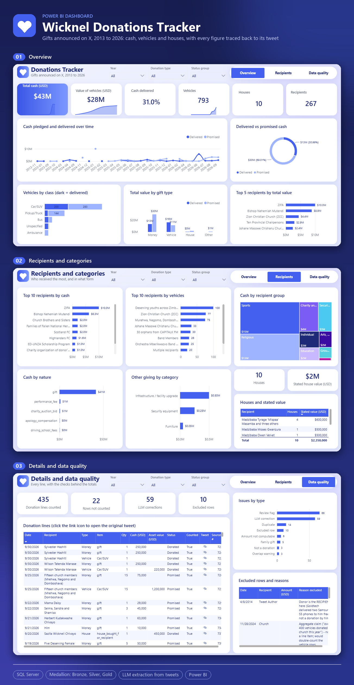
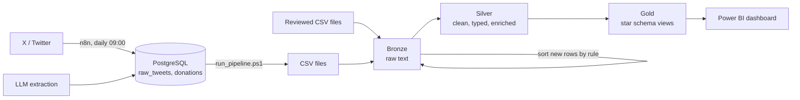

# Wicknell Chivayo Donation Data Pipeline

An end-to-end data engineering and analytics project that collects, processes, cleans and analyzes public donation announcements posted on X by the late Wicknell Chivayo.

The project processes **1,102 tweets** and transforms them into traceable data for analysis in Power BI. It uses a Medallion Architecture with Bronze, Silver and Gold layers.

> **Disclaimer:** This is a learning project. It is not affiliated with or endorsed by any person or organization. The figures reflect public announcements and are not independently verified audit results.



## Project Goals

- Automate the collection of public posts from X.
- Extract donation details from tweet text using an LLM.
- Store and organize data in PostgreSQL and SQL Server.
- Clean and check records through Bronze, Silver and Gold data layers.
- Build Power BI dashboards that link results back to their source tweets.
- Run the whole flow, from PostgreSQL to the dashboard, with one command.

## Project Results

| Measure | Result |
|---|---:|
| Announced cash donations | $43 million |
| Cash classified as delivered | $13 million |
| Cash classified as promised | $30 million |
| Vehicles | 793 |
| Estimated vehicle value | About $28 million |
| Houses | 10 |
| Recipients | 267 |

### Top Recipients by Announced Cash

| Recipient | Announced amount |
|---|---:|
| ZIFA | $10.0 million |
| Bishop Nehemiah Mutendi | $8.9 million |
| Zion Christian Church | $4.4 million |

Sports groups received about **$15 million** in announced cash, while religious groups received about **$13 million**.

### Understanding "Delivered" and "Promised"

Some gifts were announced before delivery was later confirmed, sometimes on Facebook. Because this project uses posts from X, delivery status is classified based on the wording of those posts. These labels are not independent confirmation that a donation was delivered.

## Data Pipeline



1. **Collect:** An n8n workflow runs daily at 9:00 AM and retrieves new posts through TwitterAPI.io.
2. **Store raw posts:** Tweets are saved in PostgreSQL. Unique tweet IDs help prevent duplicates.
3. **Extract information:** An LLM identifies whether a post describes a donation and extracts fields such as recipient, donation type, quantity, amount, currency, purpose and date.
4. **Load into SQL Server:** One script exports the data from PostgreSQL and loads the Bronze, Silver and Gold layers. New donations are sorted into money, vehicle, house or other giving by SQL rules.
5. **Analyze:** Gold views provide structured data for Power BI dashboards. Records can be traced back to their original tweets.

The n8n workflow is described in [n8n/README.md](n8n/README.md).

## Data Architecture

| | Bronze | Silver | Gold |
|---|---|---|---|
| Objects | 9 raw tables + a load log | 9 cleaned tables, including a data quality log | 12 views |
| Load | truncate and bulk insert | truncate and insert | none (views) |
| Transformation | none | clean, standardise, derive, enrich | star schema, aggregates, business rules |

### Bronze

Raw tables that preserve source and extracted data exactly as received. Every column is text, so nothing is changed or rejected at load.

### Silver

Cleaned tables and a data quality log. This layer supports corrections, overlap checks and the review of records that could distort the analysis.

### Gold

Star schema views (one fact, five dimensions and ready-made aggregates) designed for reporting and analysis in Power BI.

Column-level detail is in [docs/data_catalog.md](docs/data_catalog.md).

## Data Quality

- **1,102 tweets** were collected and processed.
- **435 donation lines** were counted in the analysis.
- **22 rows** were not counted in the final totals.
- **59 rows** were corrected during LLM-assisted review.
- **10 entries** were excluded, including posts where Chivayo was not the donor and aggregate claims that could double count vehicles.
- Dashboard records link back to their original tweets to support traceability.

How it is enforced:

- `bronze.load_log` records every file load: rows, duration, status and error.
- `silver.load_silver` stops if a Silver table holds fewer rows than its Bronze source.
- `silver.data_quality_issues` lists review flags, LLM corrections, duplicates, rows not counted and possible overlaps.
- Rows kept out of the totals stay in the tables with a reason that starts with `Declined:`, `Duplicate:`, `Not a donation:` or `Family:`.
- `scripts/tests/06_quality_checks.sql` returns rows only when something is wrong.

## Tools and Technologies

- **n8n**: workflow automation
- **TwitterAPI.io**: post retrieval
- **Claude AI and DeepSeek**: donation classification and information extraction
- **PostgreSQL**: raw tweet and extracted donation storage
- **SQL Server**: data warehouse and transformations (T-SQL)
- **PowerShell, psql, sqlcmd**: pipeline orchestration
- **Power BI**: dashboards and reporting

## Repository Structure

```text
.
├── n8n/                         workflow export and screenshot
├── datasets/
│   ├── raw_tweets/              tweets exported from PostgreSQL
│   ├── llm_extract/             LLM output exported from PostgreSQL
│   └── curated/                 hand-reviewed rows, exclusions, corrections log
├── scripts/
│   ├── 00_init/                 database and schemas
│   ├── bronze/                  tables and load procedures
│   ├── silver/                  tables and load procedure
│   ├── gold/                    views
│   ├── automation/              one-command pipeline and sorting rules
│   ├── tests/                   quality checks and summaries
│   └── 07_run_pipeline.sql      manual run from SSMS
├── dasboard/
│   ├── DonationsDashboard/      Power BI project (PBIP)
│   └── donations_wicknel.pbix   the same report as one file
├── docs/data_catalog.md
└── README.md
```

## Setup

Requirements: SQL Server 2017 or later, PostgreSQL client tools (`psql`), Power BI Desktop, and n8n for collection.

1. Clone the repository to `C:\donations-datawarehouse`. The load procedures use this path.
2. Give the SQL Server service account read access to `C:\donations-datawarehouse\datasets`.
3. Run these scripts in SSMS, in order:

   | Order | Script | Does |
   |---|---|---|
   | 1 | `scripts/00_init/00_create_database_and_schemas.sql` | Creates `DonationsDW`. **Drops it first if it exists.** |
   | 2 | `scripts/bronze/01_ddl_bronze.sql` | Bronze tables |
   | 3 | `scripts/bronze/02_proc_load_bronze.sql` | Bronze load procedures |
   | 4 | `scripts/silver/03_ddl_silver.sql` | Silver tables |
   | 5 | `scripts/silver/04_proc_load_silver.sql` | Silver load procedure |
   | 6 | `scripts/gold/05_ddl_gold.sql` | Gold views |
   | 7 | `scripts/automation/11_auto_pipeline.sql` | Automation procedures |

4. Copy `pipeline.env.example` to `pipeline.env` and fill in the PostgreSQL database and password.

The repository contains the reviewed CSV files, so the warehouse can be built without n8n or PostgreSQL:

```powershell
powershell -ExecutionPolicy Bypass -File scripts\automation\run_pipeline.ps1 -SkipExport
```

## Running the Pipeline

```powershell
powershell -ExecutionPolicy Bypass -File scripts\automation\run_pipeline.ps1
```

or double-click `Run pipeline (n8n to dashboard).cmd`, which also opens and refreshes Power BI.

The run:

1. Exports `public.donations` and `public.raw_tweets` from PostgreSQL to the CSV files.
2. Executes `bronze.run_pipeline`: loads Bronze, sorts every new donation, reloads Silver.
3. Writes a log to `logs\pipeline_<date>.log`.

If the export or any file load fails, Silver is not reloaded, so the dashboard keeps its last good data.

## How New Donations Are Handled

The 445 donations of the first extract were reviewed by hand. The automation never changes them.

Any donation that is not in the reviewed baseline and not in a curated file is sorted by rule:

| LLM donation type | Goes to |
|---|---|
| Cash | money |
| Vehicle | vehicle |
| Property that names a house or home | house |
| Anything else | other giving |

These rows are marked `origin = auto_rule` and `review_flag = auto_unreviewed`. They count in the totals and appear on the Data Quality page as a warning. Applied to the reviewed rows, the rules agree with the manual sorting for about 96% of them.

To review a row, add it to the matching curated CSV (or to `excluded_not_donations.csv`). From the next run its automatic version is no longer created.

## Business Rules You Can Change

All in `scripts/silver/04_proc_load_silver.sql`, section 0:

| List | Purpose |
|---|---|
| `#name_map` | spelling variants merged into one recipient |
| `#group_rule` | keyword rules for `recipient_group` |
| `#not_counted` | confirmed duplicates and family gifts |
| `#count_override` | rows counted although a general rule would exclude them |
| `#remove_rule` | declined offers removed from the donation tables |
| `#review_pending` | possible overlaps, counted until confirmed |

The ZAR rate in `silver.exchange_rate` (0.0554) is derived from one tweet.

## Limitations

- The analysis is based on public posts from X and may not include announcements made only on other platforms.
- "Promised" and "delivered" classifications are based on post wording, not independent verification.
- Some amounts and asset valuations may be estimates or reflect information stated in the source posts.
- AI-assisted extraction can make mistakes. The project includes data quality checks and source links, but results should be interpreted with these limitations in mind.
- New donations are sorted by rule and are not checked for duplicates or bundled gifts until a person reviews them.
