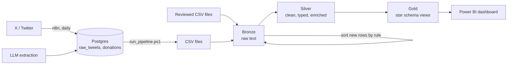

# Donations Data Warehouse

An end-to-end data project that turns public posts on X (Twitter) into a tested SQL Server
data warehouse and a Power BI dashboard.

It tracks the cash, vehicles, houses and other gifts announced by Wicknell Chivayo between
2013 and 2026. Every figure on the dashboard can be traced back to the tweet it came from.


## What it does

1. **Collect**: an n8n workflow pulls new tweets every day and stores them in Postgres.
2. **Extract**: an LLM reads each tweet and writes one structured row per gift
   (recipient, type, amount, currency, status, source excerpt).
3. **Review**: the first 445 extracted rows were checked by hand against the tweets.
   Every correction is logged, and rows that are not donations are kept with the reason.
4. **Warehouse**: SQL Server loads the data through Bronze, Silver and Gold layers.
5. **Report**: Power BI reads the Gold views.

One command runs steps 4 and 5 after n8n has finished.

## Architecture



| | Bronze | Silver | Gold |
|---|---|---|---|
| Objects | 9 tables + `load_log` | 9 tables | 12 views |
| Load | truncate and bulk insert | truncate and insert | none (views) |
| Transformation | none | clean, standardise, derive, enrich | star schema, aggregates, business rules |
| Used by | data engineers | analysts | Power BI |

Column-level detail is in [docs/data_catalog.md](docs/data_catalog.md).

## Tools

| Purpose | Tool |
|---|---|
| Collection and scheduling | n8n |
| Extraction | LLM (DeepSeek) through the n8n Information Extractor |
| Landing database | PostgreSQL 17 |
| Warehouse | SQL Server (T-SQL, medallion architecture) |
| Orchestration | PowerShell, `psql`, `sqlcmd` |
| Reporting | Power BI (PBIP project and `.pbix`) |

## Folder layout

```
datasets/
  raw_tweets/raw_tweets.csv                 tweets exported from Postgres
  llm_extract/llm_donations_extract.csv     LLM output exported from Postgres
  curated/                                  hand-reviewed rows
    money.csv  vehicle.csv  house.csv  other_giving.csv
    excluded_not_donations.csv  corrections_log.csv
    reviewed_baseline_ids.csv               ids already reviewed by hand
scripts/
  00_init/00_create_database_and_schemas.sql
  bronze/01_ddl_bronze.sql   02_proc_load_bronze.sql
  silver/03_ddl_silver.sql   04_proc_load_silver.sql
  gold/05_ddl_gold.sql
  07_run_pipeline.sql                       manual run from SSMS
  automation/
    11_auto_pipeline.sql                    sorting rules and bronze.run_pipeline
    run_pipeline.ps1                        the one command
    export_donations.sql  export_raw_tweets.sql
    n8n_node_load_warehouse.json            node to paste into the n8n workflow
  tests/                                    quality checks and summaries
dasboard/
  DonationsDashboard/                       Power BI project (PBIP)
  donations_wicknel.pbix                    the same report as one file
docs/data_catalog.md
```

## Setup

Requirements: SQL Server 2017 or later (the scripts use `STRING_AGG` and `BULK INSERT ... FORMAT = 'CSV'`),
PostgreSQL client tools (`psql`), Power BI Desktop, and n8n for collection.

1. Clone the repository to `C:\donations-datawarehouse`. The load procedures use this path.
2. Give the SQL Server service account read access to `C:\donations-datawarehouse\datasets`.
3. Run these scripts in SSMS, in order:

   | Order | Script | Does |
   |---|---|---|
   | 1 | `scripts/00_init/00_create_database_and_schemas.sql` | Creates `DonationsDW`. **Drops it first if it exists.** |
   | 2 | `scripts/bronze/01_ddl_bronze.sql` | Bronze tables |
   | 3 | `scripts/bronze/02_proc_load_bronze.sql` | Bronze load procedures |
   | 4 | `scripts/silver/03_ddl_silver.sql` | Silver tables |
   | 5 | `scripts/silver/04_proc_load_silver.sql` | Silver load procedure |
   | 6 | `scripts/gold/05_ddl_gold.sql` | Gold views |
   | 7 | `scripts/automation/11_auto_pipeline.sql` | Automation procedures |

4. Copy `pipeline.env.example` to `pipeline.env` and fill in the Postgres database and password.

The repository already contains the CSV files, so the warehouse can be built without n8n or Postgres:

```powershell
powershell -ExecutionPolicy Bypass -File scripts\automation\run_pipeline.ps1 -SkipExport
```

## Daily run

```powershell
powershell -ExecutionPolicy Bypass -File scripts\automation\run_pipeline.ps1
```

or double-click `Run pipeline (n8n to dashboard).cmd`, which also opens and refreshes Power BI.

The run:

1. Exports `public.donations` and `public.raw_tweets` from Postgres to the CSV files.
2. Executes `bronze.run_pipeline`: loads Bronze, sorts every new donation, reloads Silver.
3. Writes a log to `logs\pipeline_<date>.log`.

If the export or any file load fails, Silver is not reloaded, so the dashboard keeps its last good data.

To start it from n8n, launch n8n with `Start n8n.cmd`, paste the contents of
`scripts/automation/n8n_node_load_warehouse.json` on the workflow canvas, and connect
`Update rows in a table` to `Load warehouse (SQL Server)`.

## How new donations are handled

The 445 donations of the first extract were reviewed by hand. The automation never changes them.

Any donation that is not in the reviewed baseline and not in a curated file is sorted by rule:

| LLM donation type | Goes to |
|---|---|
| Cash | money |
| Vehicle | vehicle |
| Property that names a house or home | house |
| Anything else | other giving |

These rows are marked `origin = auto_rule` and `review_flag = auto_unreviewed`. They count in the
totals and appear on the Data Quality page as a warning. Applied to the reviewed rows, the rules
agree with the manual sorting for about 96% of them.

To review a row, add it to the matching curated CSV (or to `excluded_not_donations.csv`).
From the next run its automatic version is no longer created.

The rules do not detect duplicates or split bundled gifts. That still needs a person.

## Data quality

* `bronze.load_log` records every file load: rows, duration, status and error.
* `silver.load_silver` stops if a Silver table holds fewer rows than its Bronze source.
* `silver.data_quality_issues` lists review flags, LLM corrections, duplicates, rows not counted
  and possible overlaps.
* Rows kept out of the totals stay in the tables with a reason that starts with
  `Declined:`, `Duplicate:`, `Not a donation:` or `Family:`.
* `scripts/tests/06_quality_checks.sql` returns rows only when something is wrong.
  `09_gold_summary.sql` and `10_excluded_data.sql` show the final numbers and everything left out of them.

## Business rules you can change

All in `scripts/silver/04_proc_load_silver.sql`, section 0:

| List | Purpose |
|---|---|
| `#name_map` | spelling variants merged into one recipient |
| `#group_rule` | keyword rules for `recipient_group` |
| `#not_counted` | confirmed duplicates and family gifts |
| `#count_override` | rows counted although a general rule would exclude them |
| `#remove_rule` | declined offers removed from the donation tables |
| `#review_pending` | possible overlaps, counted until confirmed |

The ZAR rate in `silver.exchange_rate` (0.0554) is derived from one tweet.

## Notes on the data

* The source is public posts. Amounts are what the posts state; they are announcements, not audited payments.
* "Promised" and "Delivered" follow the wording of each post.
* Vehicle values are included only where a post states them.
