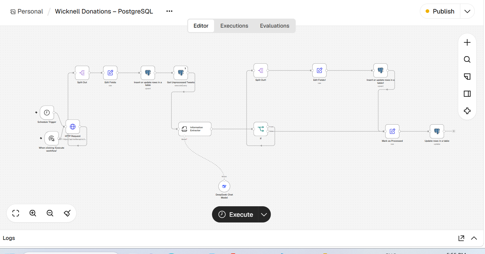

# n8n workflow

`wicknell_donations_workflow.json` is the workflow that collects tweets and extracts donations.
It holds no keys or passwords: after importing it, create the three credentials it refers to.

## What it does

1. **Schedule Trigger** runs every day at 09:00.
2. **HTTP Request** asks TwitterAPI.io for the latest posts of the account.
3. The posts are upserted into Postgres table `public.raw_tweets` (matched on `tweet_id`, so a tweet is stored once).
4. **Get Unprocessed Tweets** reads up to 20 tweets with `processed = false`.
5. **Information Extractor** (LLM) decides whether a tweet describes a donation and returns one record per gift.
6. Each gift is upserted into `public.donations` (matched on `donation_key` = tweet id + gift number).
7. The tweet is marked `processed = true`.

## Import

1. In n8n: **Workflows > Import from file**, choose `wicknell_donations_workflow.json`.
2. Create these credentials and select them in the nodes:

   | Credential | Used by |
   |---|---|
   | Postgres | the four Postgres nodes |
   | Header Auth (TwitterAPI.io key) | HTTP Request |
   | DeepSeek API (or another chat model) | Information Extractor |

3. To load SQL Server at the end of each run, start n8n with `Start n8n.cmd`, paste
   `scripts/automation/n8n_node_load_warehouse.json` on the canvas and connect
   `Update rows in a table` to `Load warehouse (SQL Server)`.
